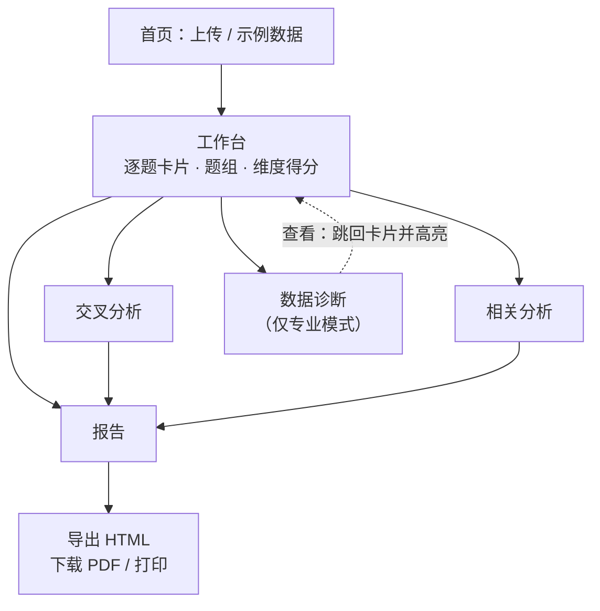
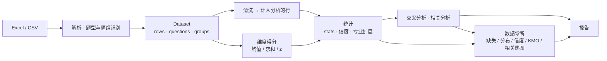

# Readout · 问卷读数

把问卷导出的 Excel 或 CSV，变成一份能直接分享的分析报告。

上传文件后自动识别题型、生成图表和关键发现；开放题可以用你自己配置的大模型归纳主题，并保留原文引用；最后打印或另存为 PDF。全程在浏览器里完成，没有后端，也不需要注册。

**在线使用：<https://l0vemiku.github.io/Readout/>** 不需要安装，打开就能用，可以先点「先看看示例数据」。

> 状态：v0.1 原型可用。已用问卷星、腾讯问卷的 4 份真实导出（117–800 份）验证解析与统计；真实 API Key 还没有完整测试。

## 现在能做什么

- **导入**：`.xlsx` / `.xls` / `.csv`，自动处理 UTF-8（容忍个别坏字节）、GBK / GB18030、Big5、UTF-16、Windows-1252 编码；多工作表的 Excel 自动选内容最多的一张，工作区和报告里会标出工作表名。表头上方有标题行也能找到表头，上限 20,000 行。平台导出的序号、提交时间、答题时长、来源、IP 等系统列自动识别为元数据；问卷星「按选项序号导出」的 `第N题(选项)` 0/1 列会合回一道多选。
- **识别题型**：单选、多选、量表、数值、开放题；文本量表（非常不符合…非常符合）按 1–5 分计分。表头形如 `第N题(子项)` 或 `题干【子项】` 的列自动组成题组，一张卡片、一个报告章节，可以手动合并或拆分，忽略时整组生效。识别错了可以在工作台里改。
- **信度**：题组里有两道以上量表子题时，给出 Cronbach's α、校正后项总相关、删除该项后的 α，只用完整作答的问卷。反向计分题可以在卡片里逐题标记；某题与其余题目负相关时会提示可能是反向题，由你确认，不会自动翻转。
- **维度得分**：题组里有两道以上量表子题时，可以在题组卡片上点「生成维度得分」，得到一道插在题组后面的数值题：各子题的均值，反向题先按题组的翻转范围折回去。缺失规则二选一——「全部子项都作答」或「至少 80% 子项有作答」；得分卡片和报告都写明口径和没有得分的份数。计分在分析视图里算，原始数据不动；题组、反向标记或子题一变，得分自动跟着变，题组被忽略或拆分时得分一并消失。完成率、有效样本和信度都不把得分算进去。
- **出图与结论**：每个题一张图加一张表，顶部有按题型轮转挑出的「关键发现」。多选里的「其他〖补充文字〗」计入「其他」，补充文字单独列出。
- **区间与检验**：占比用 Wilson 区间，量表均值用 t 区间，数值题的均值和中位数用固定种子的 Bootstrap（在后台线程计算：导入后先出表格和图表，区间稍后自动补上）；有效回答少时提示区间较宽。交叉分析给出占比差（Newcombe）、均值差（Welch）和整体的卡方 / Fisher 检验，结论句始终带差值和 95% 区间。
- **相关分析**：在「相关分析」里从数值题、量表题和维度得分中选两个以上变量，得到两两之间的 Pearson 相关系数矩阵和长表：r、Fisher z 变换的 95% 区间、双侧 p 值、成对样本量；区间不含 0 的系数加粗，另有一句结论写出最强的一对。每一对只用两者都有作答的问卷（成对删除），样本量不足 3 或取值没有变化时写明原因。
- **专业模式**（顶栏按钮，默认关；对工作台、交叉分析、相关分析和报告同时生效）：A 档一键启用——Holm / Benjamini–Hochberg 多重比较校正（只改“是否算明显差别”，区间仍不校正）、卡方效应量 Cramér's V、α 的 Bootstrap 95% 区间、偏度/峰度与逐题缺失率、三线表与 `M / SD / 95% CI` 数值格式；B 档逐项可选——Spearman 秩相关、Mann–Whitney U 与 Kruskal–Wallis（附 r、ε²）、维度得分求和 / z 分、KMO + Bartlett + 单因子 ω。关闭时所有数字与默认口径完全一致；开启后报告顶部列出启用的口径，封面与方法说明也会写明各自的方法与局限。
- **数据诊断**（专业模式开启后出现在顶栏）：一页把检查集中起来——概览、按严重度排序的「问题清单」（缺失、偏度、反向题漏标、α、KMO）、缺失率表与条形、分布表与箱线图、题组的 α/区间/KMO/Bartlett/ω、以及用相关分析已选变量画的相关热图（R 常用的 RdBu 色带、0 为白、对角线为 1 留空）。每条问题都能「查看」跳回工作台对应卡片并高亮，改完再回来看。箱线图与热图按需加载，不影响首屏。
- **数据清洗**：默认不剔除任何问卷。在「数据清洗」里添加规则（作答时长低于某值、题组全部选同一项、某题选了某个选项、完成率低于某值、正反向题矛盾），每条规则选「仅标记」或「剔除」；填好参数先看命中份数，点「应用」才生效，也可以逐份保留或剔除。报告会自动写出回收、剔除和有效的份数。
- **AI 归纳开放题**：接入 OpenAI 兼容接口，预设 DeepSeek、OpenAI、通义千问、Kimi，也可以自定义地址。引文必须是回答里逐字出现的片段，否则丢弃。
- **报告**：封面、摘要、逐题分析（含区间）、交叉分析（选了才收录）、相关分析（选了才收录）、方法说明。三个出口：**导出 HTML**（单个文件，内联样式与图表，断网可看）、**下载 PDF**（一键，按题分页；图片版，文字不可选中）、**打印 / 另存为 PDF**（矢量，文字可选中，文件更小）。开放题只收录 AI 归纳后的主题和校验过的引文，没做归纳的题目不放原始回答。

## 本地运行

需要 Node.js 22.18 或更新的版本（`npm test` 直接运行 TypeScript 文件）。

```bash
npm install
npm run dev
```

打开终端里显示的地址，点「先看看示例数据」可以直接看一份 128 份的示例问卷。示例里的题组能直接看到信度，也带有作答时长和几份敷衍作答的问卷，可以试试「数据清洗」。

```bash
npm test          # 解析、推断、统计与 AI 响应解析的单元测试
npm run build     # 类型检查并构建到 dist/
npm run gen:demo  # 重新生成示例数据
```

## 怎么用

1. 在问卷平台导出 Excel 或 CSV，拖进首页。
2. 在工作台检查题型，不需要的题改成「忽略」。
3. 量表题组里如果有反向计分题，在卡片里点「标为反向」，信度会随之更新。
4. 需要剔除无效问卷时，点「数据清洗」添加规则，先看命中份数，再点「应用」。
5. 开放题点「归纳主题」。第一次需要在「模型设置」里填自己的 API Key，填完可以点「测试连接」确认能通。
6. 想比较不同人群时，在「交叉分析」里选一道单选题作分组、再选一道题作对比，其余各组都会和人数最多的那组比较。
7. 题组是同一个维度时，在题组卡片上点「生成维度得分」，再选缺失规则；得分可以当交叉分析的对比题，也会出现在相关分析的可选变量里。
8. 想看几个数值题、量表题或维度得分之间的关系时，进「相关分析」勾选变量。
9. 打开专业模式后，顶栏多出「数据诊断」：先看问题清单，逐条点「查看」回到对应卡片处理（缺失、偏度、反向题、KMO 等）。
10. 点「生成报告」。要分享的话：一键「下载 PDF」最省事（图片版），「导出 HTML」得到可离线打开的单文件，需要文字可选中或更小的文件就用「打印 / 另存为 PDF」；选过交叉分析或相关分析的话，报告会自动收录对应的章节。

## 隐私

- 问卷数据只存在当前页面的内存里，不上传、不写浏览器存储，刷新即清除。
- API Key 只保存在当前标签页的会话中，关闭标签页即清除；接口地址和模型名会留在本机浏览器里，方便下次使用。
- 只有点击「归纳主题」时，该题的回答才会发送到你配置的服务商；「测试连接」只发送一句测试用语。不配 Key 时，其余功能都能正常使用。
- 项目代码里不含任何密钥。

## 已知边界

- 真实导出目前只回归过问卷星（按文本、按选项序号）和腾讯问卷的 4 份文件，其他平台未验证。按选项序号导出的单选题只能显示编码，无法还原选项文字；题组的自动识别目前只在问卷星 0/1 列导出和示例数据上验证过。
- AI 归纳只验证过界面和请求格式（用模拟响应），没有用真实 Key 调通过；主题人数是模型的估算，不是精确计数。
- 一键「下载 PDF」是把报告逐页截图后拼成的图片版：文件更大、文字不可选中；需要可复制文字的矢量 PDF 请用「打印 / 另存为 PDF」。导出文件包含问卷的聚合结果与开放题引文，分享前请自行确认范围。
- 2 万行上实测：导入约 1 秒，生成维度得分约 0.5 秒，切换缺失规则约 0.4 秒（本机 Chrome）。
- 不做加权；区间和检验只反映随机抽样带来的误差，不修复样本本身的偏差（如自愿填写、覆盖不全）。默认不做多重比较校正（专业模式可选 Holm 或 BH，只改判定）。
- 信度默认只算 Cronbach's α；专业模式补 α 区间、KMO、Bartlett 与单因子 ω，但不做 EFA/CFA。相关默认只做 Pearson，专业模式可选 Spearman，仍没有偏相关与回归。
- 数据诊断里的阈值（|偏度| > 1、|峰度| > 2、缺失 > 10%/20%、KMO 0.50/0.60）是常见参考线，不是判据；α 不设合格线，只给数值与「常见参考 0.70」。诊断页只列出需要你判断的线索，不自动改数据。
- 清洗规则里除了甄别题都是启发式的，会误伤真实作答，所以预选「仅标记」；问卷有跳题逻辑时，完成率规则不可靠。时长列按秒处理，文件里有起止时间时会核对两者是否一致。

## 页面与数据流





所有状态（数据、清洗、题型、得分、交叉与相关选择、专业模式）只存在当前页面的内存里；报告与三个导出都基于同一份快照。

## 技术栈

Vite + React + TypeScript · ECharts · `@e965/xlsx` + PapaParse · 纯静态，无后端、无数据库、无账号。

`@e965/xlsx` 是 SheetJS 的镜像包：npm 上的官方包停在 0.18.5，我用的是与官方 0.20.3 代码一致的版本。

## License

[MIT](LICENSE)
